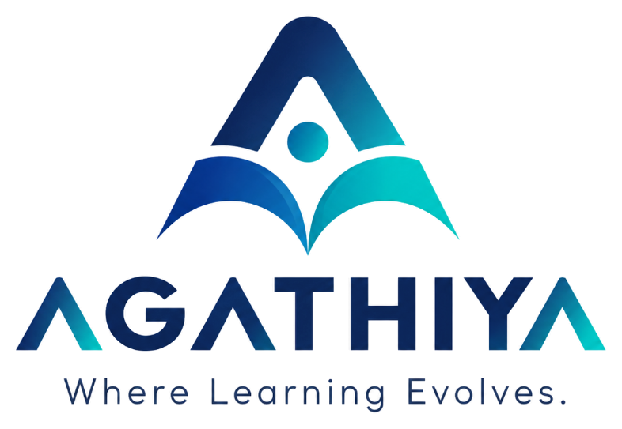

### Where Learning Evolves.

**An education-focused initiative working towards a more informed and empowered generation.**

 

  

---

## About AGATHIYA

**AGATHIYA** is an education-focused digital initiative built with a vision to make educational information, opportunities, and technology awareness more accessible to students across Tamil Nadu.

For many students, discovering the right educational pathway involves navigating multiple websites, resources, and information sources. Understanding college options, admission procedures, scholarships, and emerging career opportunities can be challenging.

AGATHIYA aims to simplify this experience by bringing relevant educational information closer to students through a unified digital platform.

We believe that access to the right information can help students make better-informed decisions about their future.

## The Challenge We Address

Educational opportunities exist, but awareness and accessibility remain important challenges.

Students may encounter difficulties such as:

- Finding reliable information about higher education.
- Understanding college options and admission pathways.
- Discovering scholarships and government-supported opportunities.
- Accessing useful academic and learning resources.
- Understanding emerging technologies and future career possibilities.
- Finding guidance when making important educational decisions.

These challenges can be particularly significant for students from underserved and geographically diverse regions.

AGATHIYA aims to make discovering such information simpler, clearer, and more accessible.

---

## Our Vision

To build an accessible educational ecosystem where students can discover opportunities, explore possibilities, and make informed decisions about their future.

## Our Mission

To bridge information gaps in education by bringing together useful resources, educational guidance, student opportunities, and technology awareness through a student-friendly digital experience.

---

## What AGATHIYA Focuses On

### 01. Educational Pathways

Explore different educational streams and opportunities, including:

- Engineering
- Arts and Science
- Diploma
- Vocational Education
- Emerging Technology

### 02. College & Admission Information

Make higher education information easier to discover, understand, and explore, with a focus on opportunities across Tamil Nadu.

### 03. Learning Resources

Bring useful educational materials and resources together to support students in their academic journey.

### 04. Scholarships & Student Support

Improve awareness of scholarships, government initiatives, and other opportunities that can support students.

### 05. Technology Awareness

Encourage students to explore emerging technologies, digital tools, and practical applications of technology.

### 06. Student Guidance

Create opportunities for students to gain insights and guidance through interactions with seniors, mentors, and experienced individuals.

---

## Who We Aim to Empower

| Audience | Intended Impact |
|---|---|
| School Students | Discover higher education pathways and opportunities. |
| College Aspirants | Explore colleges, courses, and admission information. |
| College Students | Find learning resources and explore emerging technologies. |
| Educators | Help students discover relevant educational information. |

---

## Our Approach

AGATHIYA is guided by five core principles.

| Principle | Our Commitment |
|---|---|
| Accessibility | Making educational information easier to discover. |
| Inclusivity | Working towards reaching students across different regions. |
| Clarity | Presenting information in a simple and understandable manner. |
| Awareness | Encouraging students to explore opportunities beyond their immediate surroundings. |
| Empowerment | Helping students make informed choices through knowledge and guidance. |

---

## Our Technology Foundation

AGATHIYA uses modern web technologies to build its digital platform.

  

---

## Our Commitment

We believe that a student's future should not be limited by a lack of awareness or access to information.

AGATHIYA is an evolving initiative committed to exploring ways to make educational opportunities more discoverable and learning more meaningful.

Our journey is built around one belief:

> **Every student deserves the opportunity to discover, learn, and grow.**

---

## Looking Ahead

Our long-term direction is to continue strengthening the platform through:

- More comprehensive educational resources.
- Better access to higher education information.
- Improved awareness of scholarships and student support.
- Opportunities for student interaction and guidance.
- Practical technology and digital awareness initiatives.
- A more inclusive and accessible digital experience.

*These represent our areas of focus and future direction, not a claim that every initiative is currently available.*

---

**Where Learning Evolves.**

*Discover. Learn. Grow. Empower.*

 

Building access to educational information and opportunities.

